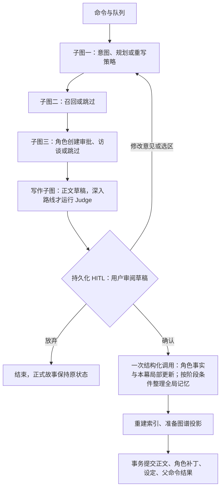

# 领域语义与扩展约定

## 后端分层

| 层 | 主要文件 | 职责 |
| --- | --- | --- |
| core | base.py、records.py、characters.py、domain.py、ports.py、config.py、errors.py、retrieval.py | Pydantic 契约、替换接口、配置与异常；不引用上层实现 |
| controller | api.py、assets.py | HTTP 参数与响应、SSE、Web 资源；业务写入提交命令 |
| service | commands.py、workflow.py、undo.py、retrieval.py、worker.py | 业务编排、命令执行、流程恢复、召回合并与撤回 |
| mapper | models.py、types.py、store.py、drafts.py、chunks.py | ORM 映射、类型化 JSON、数据库查询、原子持久化 |
| llm | service.py、gateway.py、transport.py、structured.py、discussion.py、contracts.py、schemas.py、mock.py、embeddings.py | 统一模型服务、调用策略、供应商传输、结构校验、有限重试和审计 |
| infrastructure | job_queue.py、tracing.py、checkpoints.py、graph.py | Redis 传输、日志适配器、知识图谱空实现 |
| utils | chunking.py、time.py | 无外部 I/O 的文本处理和时间函数 |
| bootstrap | runtime.py | 显式构造依赖并管理客户端生命周期 |

`cli.py` 保留为应用启动入口；前端资源仍在 `web/`。包的 `__init__.py` 不承担业务初始化，也不集中重新导出所有模块，以避免隐式依赖和循环导入。

向量 SQL 在 `mapper/chunks.py`，返回 `core/retrieval.py` 的 RecallCandidates；去重与时间排序在 `service/retrieval.py`。撤回和 NPC 审批涉及多个表的单个事务，服务层显式使用 Store 的事务会话；后续拆分 Mapper 时必须保留这个原子边界。

Redis 队列的前缀可注入，集成测试使用独立前缀，并将同一队列注入 HTTP 应用，避免消费正在创作的用户任务。普通启动保持原有 `ainovel` 前缀。

## 写作与提交

一次主指令产出一个 Scene，Chapter 是 Scene 集合。Plan.start_new_chapter 决定是否开启新章，chapter_title 是章节标题；规划器读取最近章节摘要和场景数量，根据用户自然语言与节奏作出判断。首次写作一定新建章节，新章不继承上一章的 chapter 备注。旧 GenerateRequest.new_chapter 字段仅用于兼容历史命令，不再驱动分章。NPC 的许可与档案确认是两个不同的状态迁移。

`service/subgraphs.py` 定义五个真实的 CompiledStateGraph，前三个分别是 planning、recall、characters；后面是 writing、finalize。共享 Pydantic WorkflowState，直接作为父图节点，继承父图 PostgreSQL checkpointer。子图不是日志标签或普通函数串联。planning 的 `PlanningDecision` 一次返回意图、快/深路线与场景计划；首次/尚无主线和大纲时，若缺少骨架再补一次长期规划。草稿反馈进入局部 `rewrite_plan`。快路跳过常规 Judge；深路运行 Judge，发现硬约束问题时仍可重写。

普通续写通常是 3 次模型调用：PlanningDecision、正文 Draft、确认后的 FinalizationResult；远期召回、角色咨询或用户请求深入审阅会按需增加调用。首次写作默认深路。LLMService 按结果 schema 为规划、写作、审阅、修改和确认后提取生成不同的 Pydantic 输入投影，避免每个节点重复读取整份故事、无关角色、草稿和历史正文；数据库和公共领域对象继续保留完整字段。世界观条目、角色状态、线路、伏笔和大纲在投影中保留 ID 与字段含义，供增量 patch 沿用。

Intent.use_retrieval 和 use_characters 是互相独立的 AI 决策：近期直接衔接或局部修改可以跳过远期召回、角色访谈，复杂冲突可能保留其中之一。跳过召回仍带近期正文与生效备注。需要新的持续角色时审批不可绕过；角色档案只暂存于生成状态，正式小说仍不变。草稿反馈也可以提议新 NPC，此时 review_draft 命令暂停，审批该修改命令后恢复子图；原待确认稿保持不变，修改稿完成后替换它。

草稿通过 Judge 后停在原生 `interrupt` 审阅点，GenerateRequest 返回 waiting 与 WritingDraft。命令与官方 LangGraph 检查点保存草稿、规划和版本，刷新或 Worker 重启可恢复；这时不执行 extract/maintain，不提交正文，不修改世界观、偏好、角色、大纲或作家笔记。

ReviewDraftRequest 是新的可撤回命令，携带 generation_command_id、expected_draft_version 和 confirm/revise/discard。revise 可以附带 UTF-32 码点偏移的选区及修改意见。选区重写保留两侧原文，整稿重写复用已有草稿，每次都重新审查后返回新的待确认稿。聊天输入在有待确认稿时表示修改意见，不会另外续写场景。只有点击「确认并提交」才进入最终更新子图；单纯发送“确认”文本仍是反馈。

确认操作恢复同一条图，通过一次 `FinalizationResult` 调用同时得到角色事实提取与可选 StoryMaintenance patch，然后在一个 PostgreSQL 事务中提交小说版本、索引、确认命令结果和原生成命令终态。每幕均可写入已发生的角色、世界设定和局部线路/伏笔变化；仅在首次创作、AI 深入路线、新开章，或达到 `STORY_MAINTENANCE_INTERVAL`（默认 5 幕）时更新全局大纲、主支线结构与长期笔记。检查点中的 `maintenance_checked` 区分已完成但无需整理和旧检查点未执行维护；旧检查点仍可沿旧维护路径恢复。原生成命令的等待检查点在整个处理中保持原样，失败不会污染正式状态。用户撤回确认时，一并恢复原 head 和原待确认草稿；撤回修改或放弃也恢复相应草稿版本。模型调用消耗仍保留在日志中。

旧等待点可能已经存过 resume 值。新的审阅命令通过 aupdate_state 从等待点建立独立 review 任务，再用 Command(resume=...) 执行；保持旧检查点供撤回，避免恢复旧任务时复用已撤回的确认结果。每个审阅命令有自己的 execution_command_id，步骤、用量和中间恢复状态归属于该命令。重启恢复时只读取当前命令所属的检查点分支，不覆盖其他操作。

Commit 在事务内验证当前 head、待确认稿版本及父命令状态。已有正式版本变化会阻止过期草稿确认或修改；过期草稿仍可放弃。删除、并发确认、重复投递不能越过这些检查。历史平铺图检查点首次恢复时迁到新入口，已有规划可复用，但必须经过草稿确认点。

LangGraph 官方机制参考：[子图](https://docs.langchain.com/oss/python/langgraph/use-subgraphs)、[检查点分支](https://docs.langchain.com/oss/python/langgraph/use-time-travel)。

## 统一 LLM 服务

真实模型由 `bootstrap/runtime.py` 创建 `LLMService`，业务通过 `core.ports.LanguageModel` 注入使用。结构化生成、故事讨论中的工具选择与普通回复，全部经过 `LLMService → ModelGateway → ModelTransport`。向量请求也复用传输与单次请求审计；向量使用 `Embedder` 接口，可独立配置供应商。

- `service.py`：公开入口与策略组装，不发 HTTP 请求，也不执行业务工具。
- `structured.py`、`discussion.py`：构造类型化请求并解释各模式的结果；不创建客户端，不实现重试或日志。
- `gateway.py`：唯一的响应解析、格式错误重试、结束原因检查、用量/耗时/模型返回思考记录与审计管线。网络和 HTTP 错误不会被当作格式错误反复重试。
- `transport.py`：唯一的 HTTP POST 与客户端生命周期入口；供应商的请求兼容配置（如 DeepSeek thinking）集中在这里。通过 `ModelTransport` 可替换供应商适配器或注入测试传输。
- `contracts.py`、`schemas.py`：内部 Pydantic 请求、供应商协议、输出类型与结果策略接口。

各任务仍有自己的 Pydantic 结果模型，正文修改重叠、版本冲突和角色归属等业务校验仍由业务层负责。模型输出无法直接写库或执行工具。提示词的纯构造与渲染在 `core/prompting.py`，作品绑定、版本查询与命令快照在 `service/prompt_templates.py`；LLM 层不依赖业务服务或数据库。

`client.py` 的 `OpenAIModel` 仅为旧导入保留兼容名称，不包含请求、响应或重试实现。新代码使用 `LLMService`，测试优先注入 `ModelTransport`。离线 `MockModel` 实现相同的业务接口，用于确定性集成测试。

本次统一架构没有开启供应商 strict 模式，也没有放宽关键结果字段的校验。以后调整协议或重试规则，只需修改对应网关/传输实现，两种调用模式会共同生效。

## 数据模型

`Story.field_template_set` 保存本书独立的八类初始化定义副本。模板库套装只在创建或用户显式应用时读取，后续新角色、章节和幕从本书副本初始化；已有对象的字段增删改不回写模板。副本随小说版本、字段事件及撤回保存，旧小说按已有资料派生。导出从实际资料提取无填写值的定义，并作为独立模板库命令另存新套装；详情见 `custom-fields.md`。

Story 的正式状态不再包含 setup：顶层是 title、world、preferences、writer、characters、chapters、scenes、directions、initial_snapshots 和 custom_fields。CreationProposal 只表示创建前提案；旧 StorySetup 是兼容旧输入的别名。旧 JSON 读取时转换为新模型，不就地覆盖历史版本。

| 对象 | 结构与更新规则 |
| --- | --- |
| WorldSetting | 只有 premise（简介）与 entries（开放条目）；条目名称与嵌套方式由用户和 AI 按故事需要决定 |
| ReaderPreferences | likes/dislikes 条目记录来源 explicit/inferred、置信度和是否启用；区分用户明确要求和 AI 推测 |
| WriterWorkspace | 主线、支线、伏笔、大纲、未来走向、笔记、草稿、当前进展、当前用户意图、自定义字段 |
| PlotThread / Foreshadow / OutlineBeat | 稳定 ID、状态、说明、依据、场景来源；分别记录进展与下一步、回收计划、排序和关联主线 |
| Profile | 只有 entries；记录角色档案，不预设背景、性格或语言习惯等栏目 |
| Alias | 名称、说明、形成原因、场景来源及使用者角色 ID；由最终正文提取维护，也可人工编辑 |
| CharacterState | 只有 entries；记录某一阶段的角色情况，按需区分口头表达、打算与实际行动，不设固定心理栏目 |
| Experience | 实际事件、关键词、来源场景和可选 entries；只从确认后的正文追加 |
| Entry | Pydantic 开放条目：name、value、可选 children；ID、说明、依据和场景来源用于增量更新与追踪 |

CollectionPatch 通过 upsert/remove 修改列表，按 ID 替换，保留未修改条目。同一项当前记录更新时保留 ID；新增记录创建 ID，失效记录删除。角色历史仍通过场景补丁回放。所有业务输入使用 Pydantic，children 表达嵌套结构。作家笔记的 category 也是自由文本；主线等用户明确要求的工作台结构仍保留。

旧世界观分类与旧角色字段仅在兼容读取层转换成开放条目，当前 API 和 LLM schema 不再包含这些栏目。转换使用稳定 ID，同一旧条目的后续修改和删除仍能对应；旧 fears 等记录保留内容，避免丢失旧档案。

每个角色仅保存初始 baseline。Scene.character_patches 保存 StatePatch、ProfilePatch、别名修改、自定义字段修改、新经历及原因。读取某一场景时按顺序回放补丁，生成 Snapshot DTO；正文不再为每场景复制完整角色状态和全部经历。编辑角色资料也形成补丁，因此早期场景的角色聊天仍使用当时的资料。NPC 在 introduced_scene_id 之前不可被采访。

PostgreSQL 业务表为 stories、revisions、commands、events、chunks、operations、setup_drafts；LangGraph 另外维护官方检查点表。章节、场景、记录等作为 Pydantic 聚合序列化。**小说 Revision 仍是不可变的完整聚合版本；这次改成增量的是场景内角色历史，并非整个数据库事件溯源。**

规划阶段先提出 WriterPatch；深入路线通过 Judge（快路按需跳过）且用户确认后，从最终正文提取角色补丁并记录有依据的局部故事变化。主线进展、已埋伏笔和实际经历必须依据已确认内容，未来计划不可当作既成事实。确认后的更新完成后统一事务提交。工作草稿保留最近 12 项；日常模型输入不携带无关笔记、历史工作草稿和正文，阶段整理时才读取完整工作台；数据库仍保留完整版本与日志。

创建访谈每次返回四项覆盖清单：世界观、初始角色、喜欢的风格、讨厌的写法。世界观需要定义；其他项可明确选择稍后补充。前端显示已定义、缺失、稍后定义及当前摘要，用户可随时查看已有提案。

模型网关由结果 Pydantic 模型生成一个 `submit_<模型名>` 工具，其 `parameters` 保留模型的 JSON Schema（包括递归条目和 `$defs`）。请求携带 `tools` 并通过具名 `tool_choice` 强制指定工具；只接受一次该工具调用，使用 `function.arguments` 进行 Pydantic 校验。结果工具负责收集本步骤数据，后续修改仍由原有命令处理器执行。

网关设置显式输出 token 预算。`finish_reason=length`、没有指定工具、重复或错误工具、参数 JSON 不完整或 schema 校验失败时，最多重新生成两次完整工具调用；修正提示保留原始任务。每次尝试独立记录工具名称与调用 ID、token、耗时、结束原因、原始供应商响应和错误，不自动重试网络或 HTTP 错误。可用 `LLM_MAX_TOKENS` 与 `LLM_OUTPUT_RETRIES` 调整；格式重试使用至多两倍初始输出预算。

当前使用标准 Function Calling 与本地参数校验。DeepSeek 的具名强制工具调用需要 `LLM_THINKING=disabled`，开启时会在发请求前提示配置错误；保留现有 `/v1` 接口与可省略的默认参数。

「故事设定」界面按世界观、读者偏好、AI 工作台、角色资料提供编辑。写入提交 UpdateStoryRequest 命令，和正文操作共用持久撤回栈；AI 维护在生成命令内提交，可随该轮一起撤回。

## 检索

- 目标约 1500 中文字符，优先完整段落；一段超长时允许一个 chunk 超过目标，绝不切段。空行分隔段落。
- 核心 chunk 内容互不重复；previous_context 保存上一组末句，next_context 保存下一组首句。相邻句上下文随召回返回，不重复用于 embedding。
- 每章摘要当前由已提交 Scene 摘要顺序组合，是单独的章节向量 chunk。
- Route A：摘要 top 3 章节 → 这些章节内 top 6 段落；Route B：当前 revision 全库 top 8 chunk。以 chunk ID 去重，选中的证据按故事顺序呈现。
- 最近 2 个 Scene 直接注入。真实模型输入使用 NarrativeInput，不自动发送全部章节、所有历史快照和累积经历。
- 角色 BM25 索引素材是经历，不是全篇正文，避免读到别人独处时的秘密。中文 jieba 分词、名字和别名增强查询，取 top 8 后按经历顺序呈现。

叙事检索与角色召回是两个独立策略。若以后需要角色直接召回原文，必须先给 chunk 增加可见角色/知识来源标记，不能直接复用叙事检索。

## 命令、并发与回退

CommandSubmission 带 command ID、story ID、base revision 和 discriminator payload。相同 ID、相同内容返回已有结果；相同 ID、不同内容返回冲突。HTTP 只负责提交，Worker 选择 Handler。修改所有持久故事状态都经过 Services.commit。

命令状态：queued → running → waiting / completed / failed。NPC 审批命令自身完成，同时在一个数据库事务中修改原生成命令的 checkpoint 和状态。原生成命令恢复执行，不新开一条失去关联的生成任务。

API/Worker 崩溃时，PG 保留 queued/running 命令；恢复任务每 10 秒补投 Redis。Redis 使用 FIFO list 与 processing list，队列 marker TTL 60 秒。数据库 advisory lock 保护同一 command，源版本检查保护同一 story。多个 Worker 可部署，但同一个命令只会有一个持锁执行者。

改写接受：

1. 校验建议所属小说、源版本与原选区。
2. 从源版本复制聚合；删除修改点之后的 Scene，仅在新分支删除。
3. 清除被改写场景的旧角色补丁，从其前一阶段重新提取实际状态。
4. 删除被截断未来引入的 NPC 和失效的备注目标。
5. 重建章摘要和索引，以新 revision 提交。

回退不删除版本，也不把旧版本内容就地覆盖；复制选定 revision 的完整状态，生成一个新的 revision，parent 指向回退前的当前 head。

### 连续撤回命令

UndoRequest 接受 expected_operation_id 和可选 target_command_id。不指定目标时撤回栈顶；指定对话时在一个事务中依次撤回栈顶到该命令的所有帧，不跳过中间操作。一次生成可能含等待审批及最终提交多个帧，目标取该命令最早的活动帧，审批与最终正文一并撤回。UndoHandler 调用 UndoService，在 PostgreSQL 事务中锁定小说/创建会话的操作栈，恢复 OperationMemento。小说内的所有业务命令按完成顺序共用一栈；创建前访谈按 CommandSubmission.session_id 隔离。创建前访谈、角色会话新建/聊天、建议生成、等待审批也是操作。

Memento 保存小说原 head/deleted_at 与受影响命令的 CommandMemento（status/output/checkpoint/error/undone_at）。例如接受改写额外保存建议状态，NPC 审批额外保存生成命令，删除额外保存被取消任务。每个 Handler 在改变状态前调用 Store.record_operation，凭据与效果同事务提交。纯输出型命令统一在 Store.finish 保存凭据；已自行提交的 Handler 不重复保存。业务事务失败不会提交半成品；Store.fail 另以事务记录失败终态及其撤回凭据，所以失败任务也占一层。失败的撤回、恢复命令及后台自动保存不再叠加错误帧。模型的内部步骤是一次业务命令的执行过程，不单独入栈。

撤回恢复不可变存档指针和关联命令，标记原命令 undone_at，追加审计事件，操作记录标记 undone_by。原输出、版本、索引、模型调用日志保留。聊天查询及页面上下文排除 undone 命令。撤回自身不入栈，所以可连续撤回。新操作追加到剩余栈，无需删除旧的审计记录。不提供 redo。

操作栈锁使用负数 advisory key，Worker 命令租约使用正数 key，避免自锁。并发撤回通过 expected_operation_id 校验只会生效一次；重复 command ID 不会再弹出一层。待执行审批续写可在消费前撤回，恢复为 waiting；已经运行中的工作必须先结束。撤回删除可能重新排队之前被取消的任务，其 checkpoint 一同恢复。

升级前没有 Memento 的命令不伪造可撤回状态，仍保留版本回退。收费模型调用、token 和耗时不能逆转；界面主题与导航不属于业务操作栈。

### 失败任务恢复

失败消息提供「重试」「撤回这次失败」，创建访谈、小说工作台和角色会话均可使用，刷新后从命令记录恢复。RecoverCommandRequest 携带目标命令 ID、expected_event_id 及 retry/withdraw，通过 CommandBus 处理。按作用域与最新事件 ID 校验目标仍是当前失败状态，避免跨小说操作或重复重试。重试保留源命令的输入、检查点及日志，将其重新排队，交由 Worker/持久 outbox 执行；撤回失败仅隐藏该失败请求，不改变正文。

恢复命令和源命令终态在同一事务内写入，并以 CommandMemento 保存原 failed 状态，故撤回恢复操作可以重新显示原失败记录。已排队但未执行的重试也可撤回，旧队列投递会被终态检查忽略。小说源版本已变化时拒绝重试写入类旧任务，仍允许撤回失败；角色采访保持其固定历史阶段。嵌套图重新进入提取节点时，按执行命令、正文及场景 ID 复用已经验证的提取结果，避免维护失败后重复调用提取模型。

### 创建草稿

SetupDraft 保存 session ID、标题、未发送输入、生成的 CreationProposal、设定窗口状态和 DraftFieldEdit 列表。编辑字段允许空值，避免未完成表单被正式创建提案的校验拦截。访谈内容仍由命令日志重建，不复制一份易分叉的聊天历史。

SetupDraftController 对输入立即写本地缓存，650ms 防抖提交 SaveSetupDraftRequest，pagehide 使用 keepalive，断网时保留本地副本并在重新打开时重试。SaveSetupDraftHandler 经统一命令总线调用 DraftRepository，在同一事务保存草稿与完成命令。数据库按接收事件的递增序号拒绝过期投递覆盖；旧记录兼容接收时间判断；自动保存属于界面状态投影，不额外产生一层业务撤回，且不阻塞对话撤回。

草稿列表合并保存的草稿和已有未创建的访谈会话。创建成功后通过关联 create_story 命令归档；撤回创建后恢复可见。撤回访谈同时清除来自未来轮次的设定编辑，提升保存时间屏障，延迟到达的旧 autosave 不能恢复已撤回内容。刷新后恢复未发送输入、每轮消息、待处理访谈和打开的设定窗口。

## 观测

Event 持久化，SSE 以数据库递增 ID 作为 id，支持 Last-Event-ID 或 after 参数，从日志重播。事件一次最多读取 100 条，SSE 会继续读取并发送心跳。结束与事件提交保持事务一致；连接断开不取消后台任务。

模型 Trace 包含模型、提示词版本、各次输入输出、输入/输出/缓存 token、耗时、错误与步骤摘要。供应商没有提供 token 数时保留 null，不伪造计数。演示模型显式标记 estimated。过程记录分节点列出调用用量，并把缓存输入单列（其已包含在输入 token 总数中）；这里不估算费用。输出的决策摘要不是内部推理链。

## 如何增加功能

### 故事讨论

`core/discussion.py` 定义会话、上下文、工具参数与结果；`mapper/discussions.py` 从持久命令重建会话和历史。`service/discussion.py` 处理创建与聊天命令，不经过 LangGraph，执行时读取最新版本，历史按会话隔离。`llm/discussion.py` 适配原生 `tool_choice=auto` 的自然回复或具名工具调用，并校验 Pydantic 参数、记录用量和逐次调用。

`search_story` 按需调用现有检索；`update_story_settings` 由 `service/discussion_tools.py` 对副本应用元数据及角色补丁，校验章节、正文、摘要和正文来源未改变。修改在当前轮内暂存，可反馈给模型继续讨论；收到最终回复才与命令输出、事件和撤回凭据一起原子提交。读会话不创建版本。模型失败、步数耗尽或版本冲突不会写入暂存结果。相同会话通过租约串行执行，不同会话通过版本比较保护共享设定。

`web/discussion.js` 管理会话选择、输入草稿、队列状态、SSE 恢复和撤回；`web/chat-text.js` 用安全 DOM 渲染基础 Markdown。页面入口为 `/discussion?story=<id>`，所有写入仍使用 `/api/commands`。

1. 在 core/domain.py 增加 Pydantic 请求类型、输入/输出模型；把请求加入 discriminator union。
2. 在 service/commands.py 新建 Handler，定义 request_type 与 execute，加入 CommandBus 的处理器元组。
3. 通过 Services/ports 使用存储、模型与检索，不让 Handler 依赖 FastAPI Request 或浏览器实现。
4. 返回 Proposal 的操作只写命令输出；改变正文的操作从 source 复制、校验、commit。
   若直接修改关联命令或其他持久状态，必须在同一事务内先调用 record_operation 并提供 related_ids，然后原子完成当前命令。新增聚合字段必须纳入类型化 Memento；不能依赖内存撤回栈。
5. 增加能证明业务不变量的测试，例如版本冲突不覆盖正文，而不是测试每个赋值。

KnowledgeGraph.prepare 只能校验/准备，不能提前改变 canonical graph。未来从持久的 story.committed 事件调用 reconcile(revision)，按 revision 做幂等投影；图谱暂时不可用不应阻塞已经成功提交的故事。

模型网关与 embedding 通过 core/ports.py 的 Protocol 替换；若引入其他供应商，领域和命令层不需要改变。bootstrap/runtime.py 分别组装聊天与 embedding，支持 DeepSeek 的具名工具调用、缓存 token 统计，以及两套环境变量名称。

## 删除生命周期

StoryRow.deleted_at 是回收站标记。delete_story / restore_story 都是命令，并在同一事务中写入生命周期状态、命令结果和事件，不创建正文版本。删除保留 revisions、chunks、角色补丁、commands 和审计，普通查询返回不可用，书架的 deleted 查询只提供恢复所需元数据。

删除事务锁定 story，取消该作品 queued/running/waiting 命令并生成失败终态事件。未完成的图节点不能继续写 checkpoint；提交时重新检查作品是否删除与命令是否运行，防止异步生成恢复作品。恢复不恢复已取消的任务。NPC 审批同样在写入前重新检查作品与命令状态。

主题是浏览器偏好，不属于小说状态。共享 ThemeController 负责系统初始值、localStorage 持久化和跨页面同步；两个页面统一使用主题 token。
